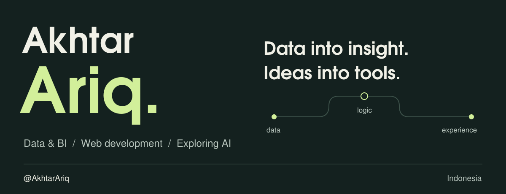

<picture>
  <source media="(max-width: 600px)" srcset="./assets/hero-mobile.svg">
  
</picture>

  <a href="#skills">Skills</a> &nbsp; / &nbsp;
  <a href="#github-activity">Activity</a> &nbsp; / &nbsp;
  <a href="https://github.com/AkhtarAriq?tab=repositories">Repositories</a>

I'm **Muhammad Akhtar Ariq**, an Information Systems student at UPN “Veteran” Jawa Timur. I work across **data, business intelligence, and web development**.

## Skills

| Area | Tools I work with |
| :--- | :--- |
| **Languages** | TypeScript · JavaScript · PHP · SQL |
| **Web development** | React · Next.js · Tailwind CSS |
| **Databases** | PostgreSQL · MySQL |
| **Data & BI** | Pentaho PDI · Tableau · ETL · Dimensional modelling |

**Currently exploring:** machine learning, AI agents, and workflow orchestration.

## GitHub activity

  

  Updated daily with <a href="https://github.com/lowlighter/metrics">Metrics</a> · Asia/Jakarta

---

**Have an idea worth building?** [Start a public conversation →](https://github.com/AkhtarAriq/AkhtarAriq/issues/new?title=Let%27s%20connect)
