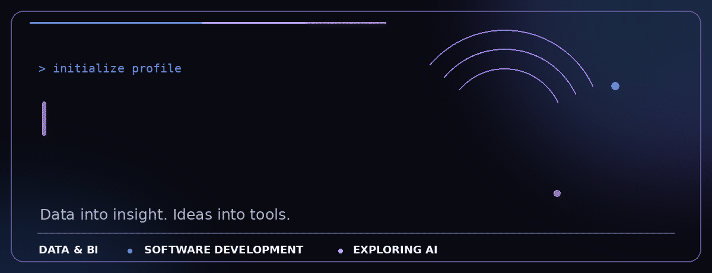
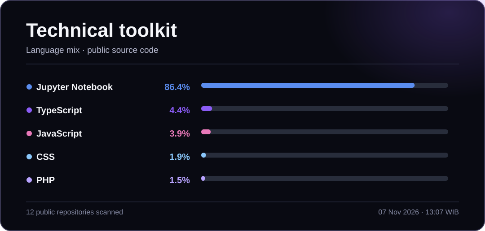
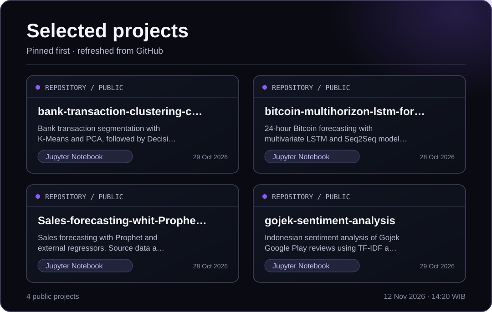
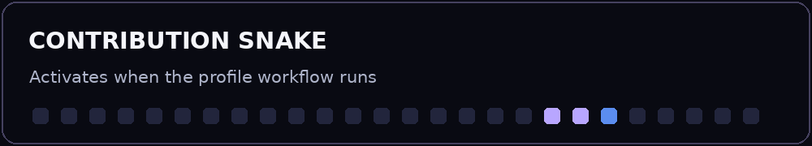

<picture>
  <source media="(prefers-reduced-motion: reduce)" srcset="assets/hero-static.png" />
  
</picture>

  
  

### 01 / About me

I'm **Muhammad Akhtar Ariq**, an Information Systems graduate who enjoys connecting **data, business intelligence, and software engineering** to build useful digital experiences. I work across analytics pipelines and web applications, and I'm exploring the foundations of AI and how to apply it thoughtfully to real problems.

> Curious about the *why* behind a system—and the details that make it work well.

### 02 / Technical toolkit

<picture>
  <source media="(max-width: 600px)" srcset="assets/language-stack-mobile.svg" />
  
</picture>

Repository-weighted language mix, not a proficiency score. Calculated from eligible public, original repositories and updated daily.

### 03 / Selected projects

<picture>
  <source media="(max-width: 600px)" srcset="assets/projects-mobile.svg" />
  
</picture>

<a href="https://github.com/AkhtarAriq?tab=repositories">Explore all repositories ↗</a> · <a href="https://akhtarariq.vercel.app/">See project case studies ↗</a>

### 04 / Contribution trail

Generated from my GitHub contribution graph. The animation refreshes automatically with the other profile visuals.

---

**Let's build something useful.**

If you're interested in data, software, or practical AI, take a look at my [portfolio](https://akhtarariq.vercel.app/) and [projects](https://github.com/AkhtarAriq?tab=repositories).

Made with curiosity · Updated by GitHub Actions

